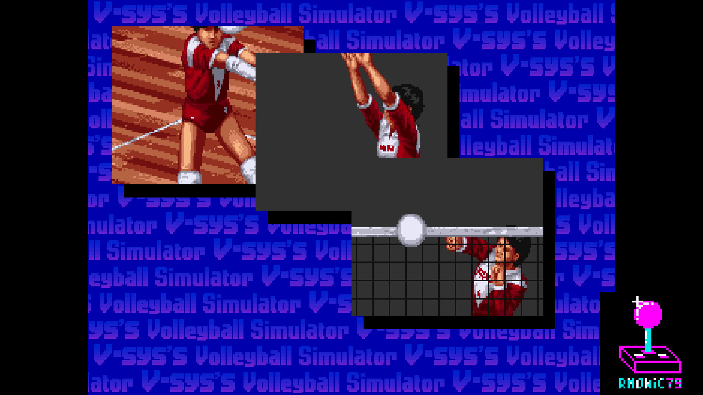
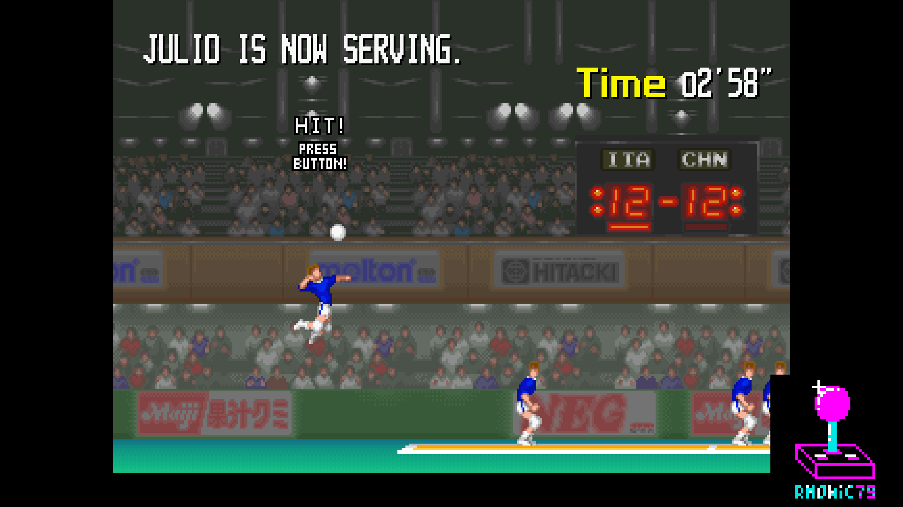
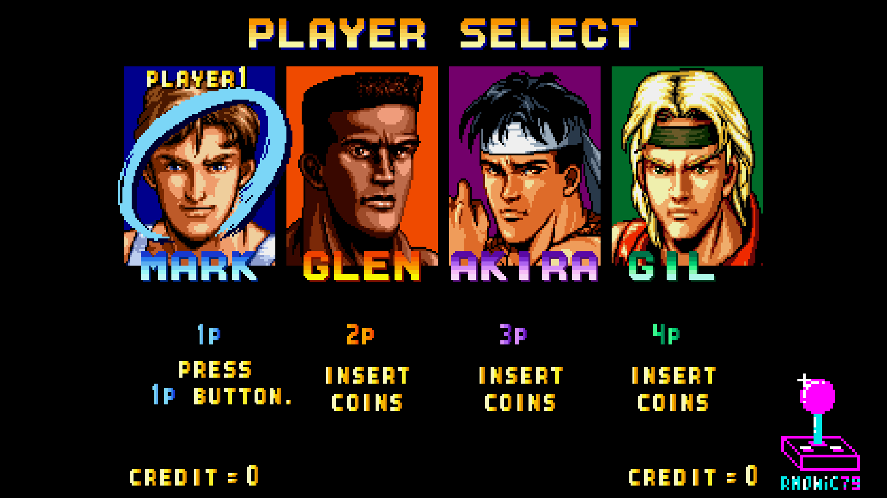
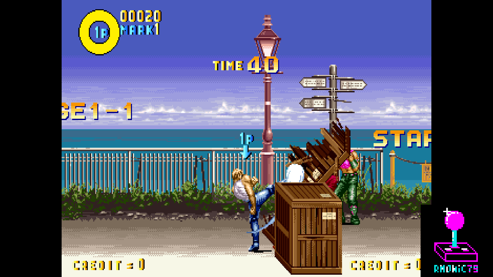
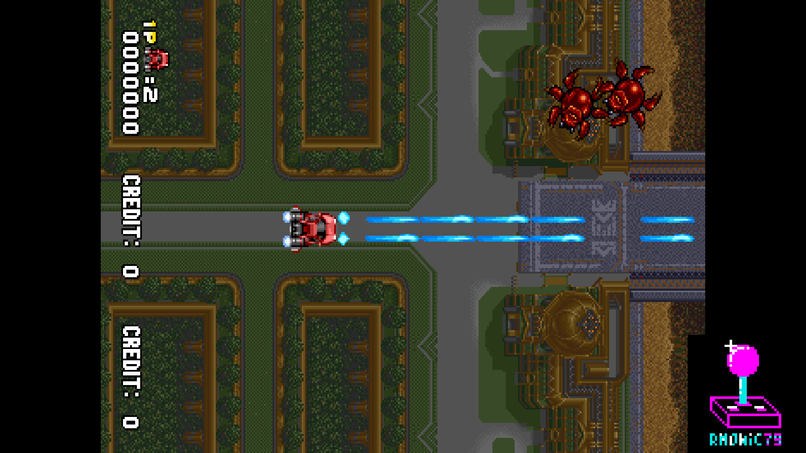
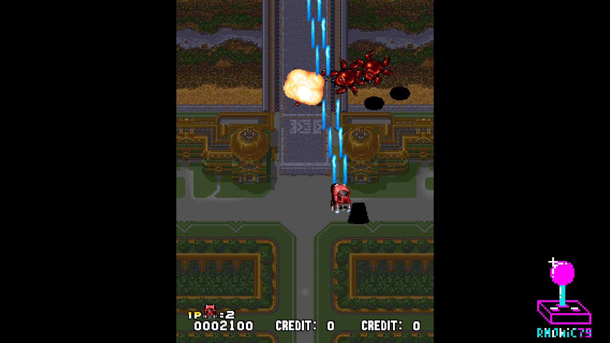

# rm_PowerSpikes_MiSTer

FPGA core for the **Video System Co.** 68000 arcade boards of 1991–1992 —
**Power Spikes**, **Karate Blazers**, **Turbo Force** and **Aero Fighters /
Sonic Wings** — targeting the [MiSTer FPGA](https://github.com/MiSTer-devel)
platform (Terasic DE10-Nano).

The game core is by **Andrea Bogazzi**. This repository is its **rm** edition:
Andrea's core runs unchanged on the rm framework (Template, `sys/`, OSD,
inputs, ROM loading, CRT geometry, pause overlay), with the rm video features
on top — including **CRT Rotate**, which brings the vertical games to a
horizontal 15 kHz CRT already rotated, without a frame buffer.

## Status

**Current version: 1.0** (October 2026).

## Games

All sets use the same RBF, `rmPowerSpikes`.

| Game | Year | MRA (parent) | Alternatives |
|---|---|---|---|
| Power Spikes | 1991 | `rm Power Spikes (World).mra` | Korea, US, Super Volley '91 (Japan) |
| Karate Blazers | 1991 | `rm Karate Blazers (World, set 1).mra` | World set 2, US, World (Tecmo license), Toushin Blazers (Japan) |
| Turbo Force | 1991 | `rm Turbo Force (World, set 1).mra` | World set 2, US set 1, US set 2 |
| Aero Fighters / Sonic Wings | 1992 | — | Aero Fighters (Taiwan - Japan, set 1 and set 2), Sonic Wings (Japan) |

Turbo Force and Aero Fighters are **vertical** games; Power Spikes and Karate
Blazers are horizontal.

## Features

**From the rm framework**

- **CRT Adjust**, placed sys-side so that HDMI stays bit-identical while the
  analog output is aligned to a tube: H-Size, H-Position, V-Shift and V-Size,
  with **PVM** and **Cabinet** V-Size modes.
- **Pause overlay** with logo, header and patrons; *Clean Pause* hides it.
- **Rotate** (CCW / CW) and **Flip 180** for the vertical games on HDMI.
- Aspect ratio and integer scaling options.
- **DB15 joystick** on the user port.
- **ROM loading** from the MiSTer download or from DDR.

**CRT Rotate** — vertical games on a horizontal 15 kHz CRT

The vertical games come out already rotated on the analog output, at 15 kHz,
with **no frame buffer and no added latency**. A column renderer redraws the
picture column by column, straight from the game's video memories, while the
beam sweeps the lines. It reads the same memories and ROM slots as Andrea's
renderer and takes over their ports while the rotation is on.

- **Fit: Fusion** — every column of the game is shown: the columns are fused
  into the lines of the tube, mixed in light.
- **Fit: Cut** — one game column per line, 1:1, through a window as tall as the
  screen allows.
  - **Camera: Fixed** — the window sits where *Cut Pos* puts it, in 8-column
    steps.
  - **Camera: Follow** — the window follows the player ships, like the camera
    of Darius rework: it centres on the ships (on the midpoint when several
    players are in), moves 4 / 2 / 1 columns per frame and rests inside a small
    dead zone; with no ship in play it goes back to the centre.
  - The **fixed on-screen texts** (score, INSERT COIN, CREDIT) move with the
    window, so they stay on screen: texts near an edge keep their distance from
    that edge of the window, texts in the middle stay in the middle.

**Refresh Rate**

- **Original** — the game's own timing: Turbo Force 61.3 Hz (256 lines),
  Aero Fighters 62.8 Hz (250 lines).
- **60Hz** — 262-line frame at 59.92 Hz, with the same line rate; the extra
  lines are blanking, the picture is unchanged. The games follow the frame:
  Turbo Force runs 2.2% slower, Aero Fighters 4.6%.

## OSD

| Entry | Values |
|---|---|
| Aspect ratio | Original, Full Screen, [ARC1], [ARC2] |
| Scale | Normal, V-Integer, Narrower HV-Integer, Wider HV-Integer, HV-Integer |
| Refresh Rate | Original, 60Hz |
| Rotate / Flip 180 | vertical sets only |
| CRT Adjust | Off, On — then H-Size, H-Position, V-Shift, V-Size, V-Size Mode |
| CRT Rotate | Off, CCW, CW — vertical sets, with CRT Adjust on and no scandoubler |
| CRT Rotate Fit | Fusion, Cut |
| CRT Rotate Camera | Fixed, Follow — with Cut |
| CRT Rotate Cut Pos | 0, +1..+8, −8..−1 — with Cut and Fixed camera |
| Clean Pause | Off, On |
| User Port | Off, DB15 Joystick |
| DIP | game DIP switches |

## Screenshots

| | |
|---|---|
|  |  |
| Power Spikes — intro | Power Spikes — match |
|  |  |
| Karate Blazers — player select | Karate Blazers — stage 1-1 |
|  |  |
| Turbo Force — native orientation | Turbo Force — rotated |

## Hardware

| Component | Implementation |
|---|---|
| Main CPU | Motorola 68000 (fx68k) |
| Sound CPU | Z80 (T80) |
| Sound | Yamaha YM2610 (jt10) |
| Video timing | Video System GGA C7-01 |
| Sprites | VS8904 / VS8905 sprite chips |
| Graphics ROMs | SDRAM (JTFRAME SDRAM64) |

## Building from source

Requires Quartus Prime 17.0 (free Lite Edition).

```
rm -rf db incremental_db
quartus_sh --flow compile rmPowerSpikes
```

The bitstream for the MiSTer is `output_files/rmPowerSpikes.rbf`; every
compile also leaves a dated copy, `output_files/rmPowerSpikes_YYYYMMDD.rbf`.

## Running on MiSTer

The [releases/](releases/) folder contains the MRA files and a prebuilt RBF:

- `rmPowerSpikes_YYYYMMDD.rbf` — prebuilt bitstream;
- one MRA per game at the top level, the other sets in `_alternatives/`.

Steps:

1. Copy the `.rbf` to `_Arcade/cores/` on the SD card.
2. Copy the `.mra` files and the `_alternatives/` folder to `_Arcade/`.
3. Provide your legally-owned MAME ROM zips where the MRAs expect them
   (usually `games/mame/`).

**ROMs are NOT included in this repository.**

## Repository layout

```
rm_PowerSpikes_MiSTer_Public/
├── rtl/
│   ├── pspike/          Andrea Bogazzi's core + the CRT Rotate renderer
│   │                    (jtpspike_video_rot.sv, rot_sqrt.hex)
│   ├── common/          rm modules: pause overlay, DB15, ROM loading,
│   │                    rm_rot_cam (ships and texts for CRT Rotate)
│   ├── fx68k/           68000 CPU
│   ├── t80/             Z80 sound CPU
│   ├── jt12/            YM2610 (jt10) and jt49
│   ├── jtframe/         the JTFRAME modules the core uses
│   └── pll/             clock PLL
├── sys/                 MiSTer framework, rm line
├── logo/                pause overlay logo, header, patrons and font
├── docs/                screenshots
├── releases/            MRA files and prebuilt RBF
├── rmPowerSpikes.qpf    Quartus project
├── rmPowerSpikes.qsf    Quartus assignments
├── Template.sv          top level
├── Template.sdc         timing constraints
├── files.qip            HDL file list
└── build_id.v           build stamp
```

## Andrea's core and the rm changes

Andrea's files are kept as they come. Where the rm features need a hook
inside them, the change is limited to passing ports through, plus two small
hooks:

- the column renderer instance and its port switch in `jtpspike_video.v`;
- the 60 Hz line total in `jtpspike_gga.v`.

Everything that depends on the game programs lives in rm files.

## Acknowledgements

- **Andrea Bogazzi** ([@asturur](https://github.com/asturur)) for the Video
  System core.
- **Jose Tejada** ([@jotego](https://github.com/jotego)) for JTFRAME and the
  jt10 / jt12 / jt49 sound cores.
- **Jorge Cwik** for the fx68k 68000 core.
- The authors of the **T80** Z80 core.
- **Aitor Pelaez** for the DB15 joystick reader.
- The **MAMEDev team** for the reference on this hardware.
- **Sorgelig** and the **MiSTer-devel team** for the framework.

## Support this project

- [Ko-fi](https://ko-fi.com/ibecerivideoludici) — one-time support
- [Patreon](https://www.patreon.com/IBeceriVideoludici) — monthly support
- [PayPal](https://www.paypal.me/IBeceriVideoludici) — one-time donation

## Follow

- [GitHub](https://github.com/rmonic79)
- [Twitch](https://twitch.tv/ibecerivideoludici) — live streams
- [YouTube](https://www.youtube.com/c/IBeceriVideoludici) — playlists and videos
- [X / Twitter](https://x.com/rmonic79)

## License

The RTL source code is provided under **GNU GPL v3 or later** (see
[LICENSE](LICENSE)). Original ROM data is not included; users must provide
their own legally obtained copies.

Original arcade hardware © Video System Co., 1991–1992.

